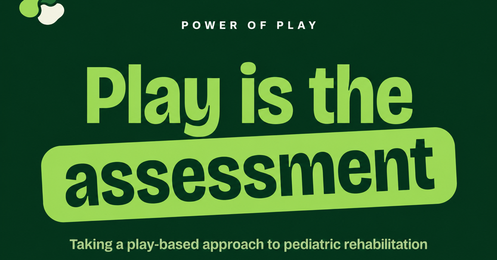

### About Me
I'm a Computer Science student at Wilfrid Laurier and a freelance product designer and frontend developer. I like taking a product from the first sketch to the shipped interface: research and design systems in Figma, then the React, Next.js or React Native code behind them. Lately that has meant live websites for healthcare clients, a Fire TV app with an AI backend, and game-playing AI agents.

*   **B.Sc. in Computer Science** @ Wilfrid Laurier University *(Minor in UX Design, Option in Leadership)*
*   **Freelance Product Designer & Frontend Developer** – Digital interfaces, design systems, and web architectures
*   **President** @ Bangladeshi Students' Association (BSA Laurier) – Campus operations, leadership, and community outreach

---

### 🚀 Featured Projects

<table border="0">
  <tr>
    <td width="50%" valign="top">
      
      <h3><a href="https://github.com/Agrolax/huddle-tv">Huddle Home</a></h3>
      
<b>Personal project · First MVP, in progress</b>

      
A family home screen for Fire TV. Phones join by QR code and become the remote, a private ballot and the pens. Amazon Bedrock (Nova) picks what to watch before bedtime with real movie posters from TMDB, and game night is a quiz about your own week or a draw-and-guess round where one phone is the pen.

      
<a href="https://github.com/Agrolax/huddle-tv">Repository</a> · <a href="https://github.com/Agrolax/huddle-tv#screens">Screenshots</a>

      
      
      
      
      
    </td>
    <td width="50%" valign="top">
      
      <h3><a href="https://github.com/Agrolax/ConnectFourAI">ConnectFourAI</a></h3>
      
<b>Course project · CP468 Artificial Intelligence, Wilfrid Laurier</b>

      
A Connect Four engine with seedable adversarial AI agents (minimax, alpha-beta and more) and a web sandbox for watching them search and play against each other, with an evaluation report comparing the agents.

      
<a href="https://agrolax.github.io/ConnectFourAI/">Live sandbox</a> · <a href="https://github.com/Agrolax/ConnectFourAI">Repository</a>

      
      
      
    </td>
  </tr>
  <tr>
    <td width="50%" valign="top">
      
      <h3><a href="https://powerofplayinc.com">Power of Play</a></h3>
      
<b>Client work · Live</b>

      
The website for Power of Play, a pediatric rehabilitation company that takes a play-based approach to therapy and assessment for young children. Taken from HTML prototypes of several design directions to the production Home, About and Contact pages.

      
<a href="https://powerofplayinc.com">powerofplayinc.com</a>

      
      
      
      
      
    </td>
    <td width="50%" valign="top">
      
      <h3><a href="https://relliahealth.com">Rellia Health</a></h3>
      
<b>Client work · Live</b>

      
The marketing website for Rellia Health, a network that connects digital health founders, clinicians and health systems. | CMS integration and a custom admin dashboard.

      
<a href="https://relliahealth.com">relliahealth.com</a>

      
      
      
    </td>
  </tr>
</table>

---

### ⚙️ Tools & Tech Stack

**Design & UI/UX**
 

**Frontend & Mobile**
      

**Languages & Backend**
     

**Cloud & AI**
  

**Environment & Agentic Tools**
   

---

### 📫 Connect with Me

[LinkedIn](https://linkedin.com/in/safdarmd) · [Dribbble Portfolio](https://dribbble.com/safdarmd) · [Email](mailto:work.safdarmd@gmail.com)

✨ *Personal website & full portfolio coming soon!*
