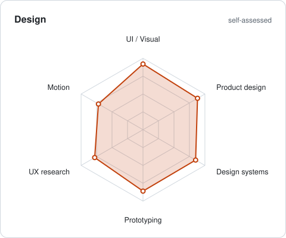
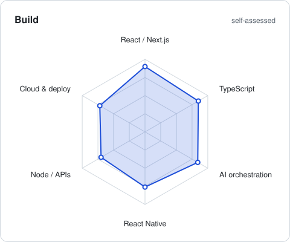
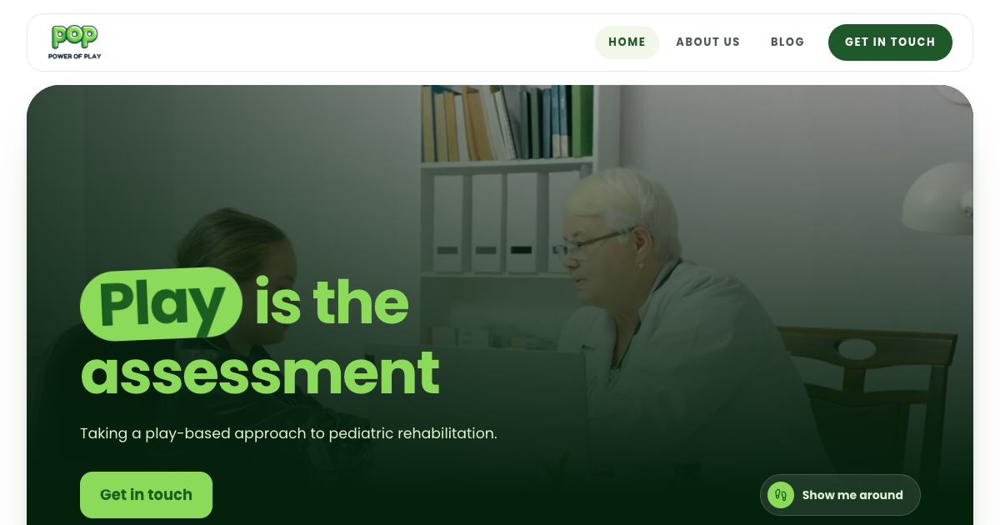
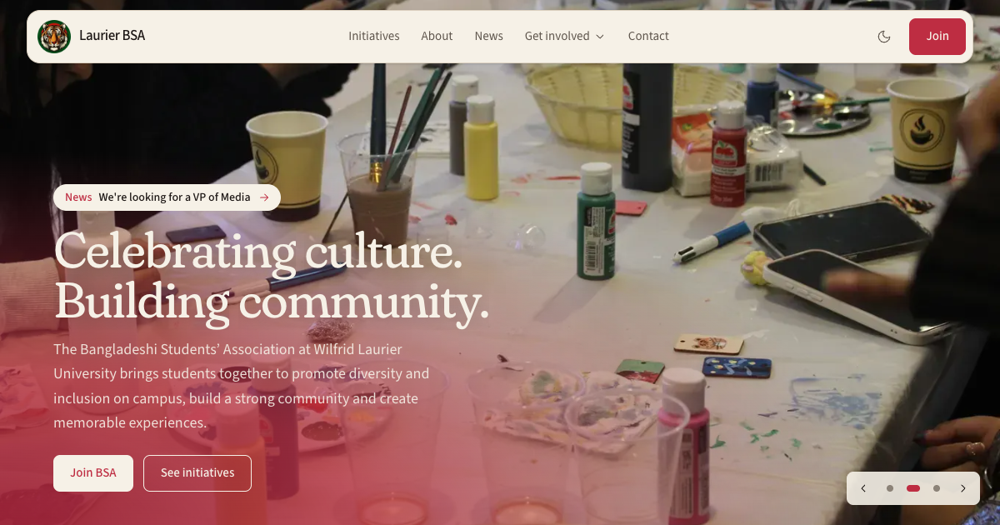

# Safdar Shukur

**Product Design & Engineering · AI Fluency & Orchestration · CS @ Laurier**

4th-year Computer Science at Wilfrid Laurier (UX Design minor, Leadership option). I freelance as a product designer and frontend developer — sketch → system → shipped interface. Available for new projects.

[LinkedIn](https://linkedin.com/in/safdarmd) · [Dribbble](https://dribbble.com/safdarmd) · [Email](mailto:work.safdarmd@gmail.com)

---

### Focus

  <picture>
    <source media="(prefers-color-scheme: dark)" srcset="./assets/skills-design-dark.svg" />
    
  </picture>
  <picture>
    <source media="(prefers-color-scheme: dark)" srcset="./assets/skills-build-dark.svg" />
    
  </picture>

Also: Founder & President, [Laurier BSA](https://laurierbsa.ca) — campus ops & community.

---

### Selected work

Live client and campus work first. Personal builds when they’re worth a look.

<table border="0">
  <tr>
    <td width="50%" valign="top">
      
      <h3><a href="https://www.relliahealth.com">Rellia Health</a></h3>
      
<b>Client · Live</b> — Marketing site, headless CMS, and internal dashboard for a digital-health network connecting founders, clinicians, and health systems.

      
      
      
       <a href="https://dribbble.com/shots/27740817-Rellia-Health-React-Headless-CMS-Internal-Dashboard">Case study on Dribbble →</a>
    </td>
    <td width="50%" valign="top">
      
      <h3><a href="https://powerofplayinc.com">Power of Play</a></h3>
      
<b>Client · Live</b> — Production Home, About, and Contact from design directions through Next.js on Netlify.

      
      
      
      
      
    </td>
  </tr>
  <tr>
    <td width="50%" valign="top">
      
      <h3><a href="https://laurierbsa.ca">Laurier BSA</a></h3>
      
<b>Campus · Live</b> — Site for the Bangladeshi Students’ Association: culture, events, and getting involved on the Waterloo campus.

      
      
      
      
      
    </td>
    <td width="50%" valign="top">
      
      <h3><a href="https://agrolax.github.io/ConnectFourAI/">ConnectFourAI</a></h3>
      
<b>Course · Live</b> — Adversarial agents (minimax, alpha-beta, more) with a web sandbox to watch them search and play. CP468 AI @ Laurier.

      
      
      
       <a href="https://github.com/Agrolax/ConnectFourAI">Repository →</a>
    </td>
  </tr>
  <tr>
    <td width="50%" valign="top">
      
      <h3><a href="https://github.com/Agrolax/huddle-tv">Huddle Home</a></h3>
      
<b>Personal · MVP in progress</b> — Family home screen for Fire TV (Vega OS): phones join by QR, Bedrock picks what to watch, secret votes and game night.

      
      
      
      
      
    </td>
    <td width="50%" valign="top"></td>
  </tr>
</table>

---

### Design on Dribbble

UI, UX research, and case studies beyond the shipped sites — including DesignRepo, Hawk Hub, ClassPass heuristic evaluation, Habit Hero, and design-system work.

**[dribbble.com/safdarmd →](https://dribbble.com/safdarmd)**

---

### Stack

**Design**  
 

**Frontend & mobile**  
    

**Languages & backend**  
     

**Cloud & AI**  
   

**Environment**  
   

---

### Connect

Open to freelance product design and frontend work.

[LinkedIn](https://linkedin.com/in/safdarmd) · [Dribbble](https://dribbble.com/safdarmd) · [Email](mailto:work.safdarmd@gmail.com)
