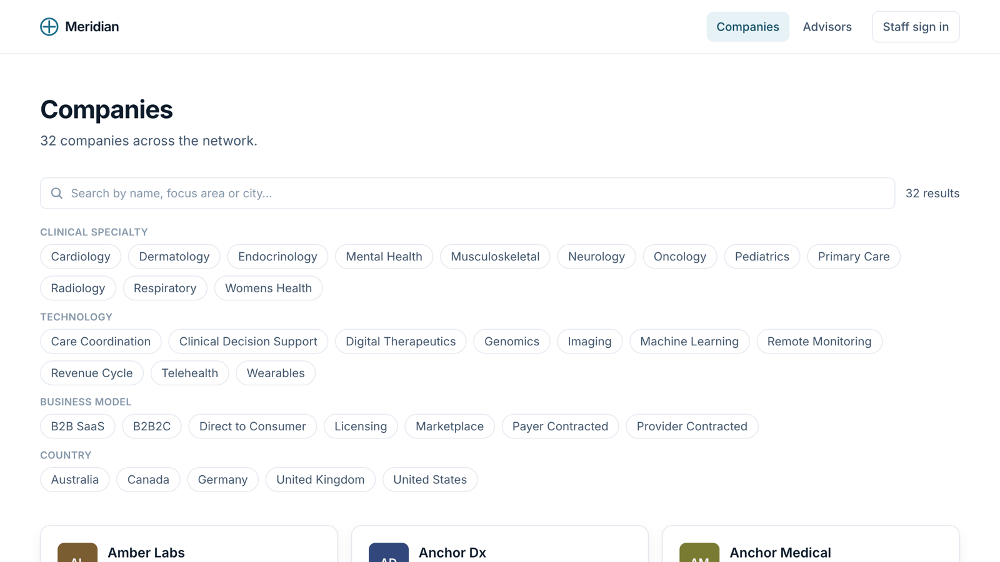

### 🚀 Featured Projects

<table border="0">
  <tr>
    <td width="50%" valign="top">
      
      <h3><a href="https://github.com/Agrolax/huddle-tv">Huddle Home</a></h3>
      
A family home screen for Fire TV. Phones join by QR code and become the remote, a private ballot and the pens. Amazon Bedrock (Nova) picks what to watch before bedtime, and game night is a quiz about your own week. Built for the Amazon Developer Hackathon.

      
      
      
      
      
    </td>
    <td width="50%" valign="top">
      
      <h3><a href="https://github.com/Agrolax/ConnectFourAI">ConnectFourAI</a></h3>
      
A Connect Four engine with seedable adversarial AI agents (minimax, alpha-beta and more) and a web sandbox for watching them search and play against each other. CP468 Artificial Intelligence, Wilfrid Laurier.

      
<a href="https://agrolax.github.io/ConnectFourAI/">Live sandbox</a>

      
      
      
    </td>
  </tr>
  <tr>
    <td width="50%" valign="top">
      
      <h3><a href="https://github.com/Schleed/habit-hero">Habit Hero</a></h3>
      
A gamified to-do and habit tracker: tasks and streaks earn XP and gold to spend in an item shop on your avatar.

      
      
      
    </td>
    <td width="50%" valign="top">
      
      <h3><a href="https://github.com/Agrolax/meridian-network">Meridian Network</a></h3>
      
A full-stack directory platform: a public, filterable member directory backed by an authenticated staff dashboard that controls what the public sees. Typed API, URL-driven filters, session auth and a test suite.

      
      
      
      
    </td>
  </tr>
</table>

**Also:** [Rellia Health](https://relliahealth.com) – marketing website and custom admin dashboard with a CMS integration (React, TypeScript, Tailwind CSS).

---

### ⚙️ Tools & Tech Stack

**Design & UI/UX**
 

**Frontend & Mobile**
    

**Languages & Backend**
   

**Environment & Agentic Tools**
  

---

### 🎓 Education & Experience
*   **B.Sc. in Computer Science** @ Wilfrid Laurier University *(Minor in UX Design, Option in Leadership)*
*   **Freelance Product Designer & Frontend Developer** – Digital interfaces, design systems, and web architectures
*   **President** @ Bangladeshi Students' Association (BSA Laurier) – Campus operations, leadership, and community outreach

---

### 📫 Connect with Me

[LinkedIn](https://linkedin.com/in/safdarmd) · [Dribbble Portfolio](https://dribbble.com/safdarmd) · [Email](mailto:work.safdarmd@gmail.com)

✨ *Personal website & full portfolio coming soon!*
